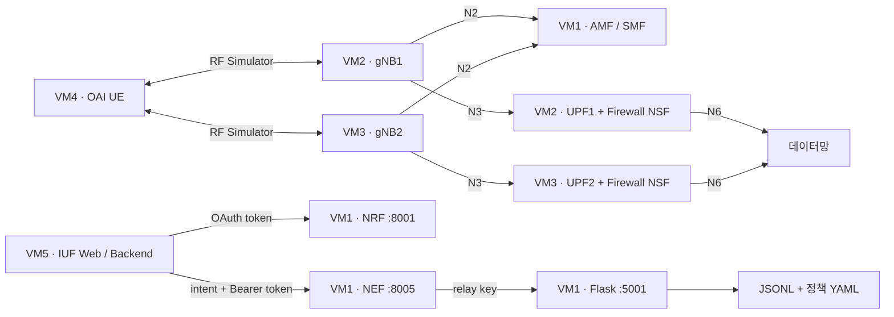

# OAI + free5GC N2 Handover · I2NSF 통합 실습 가이드

OAI RF Simulator로 두 gNB 사이의 N2 핸드오버를 실행하고, UPF의 Firewall NSF를 수동으로 시험하며, IUF 웹에서 보낸 intent를 NEF를 통해 Core의 정책 YAML로 변환하는 실험 저장소입니다.

이 브랜치(`codex/unified-beginner-guide`)는 `main`의 gNB·UE·UPF·방화벽 구성과 `feature/iuf-nef-flask-relay`의 IUF·NEF·Core Flask 코드를 한곳에서 읽고 실행할 수 있도록 정리했습니다. 원래 두 브랜치는 그대로 유지합니다.

## 1. 처음 시작하는 순서

| 순서 | 문서 | 완료 기준 |
|---|---|---|
| 0 | [VM·도구·소스 준비](docs/00-environment.md) | Linux 접속, Docker, gtp5g, OAI 빌드, 공통 변수 |
| 1 | [Core·UPF·gNB·UE와 N2 핸드오버](docs/01-handover.md) | UE 터널, 기본 통신, 핸드오버 로그 |
| 2 | [Firewall NSF 적용·해제](docs/02-firewall.md) | UE 차단 → DROP counter 증가 → 해제 후 복구 |
| 3 | [Core NEF·Flask 정책 변환기](core/README.md) | 수정한 NEF, OAuth, Flask health |
| 4 | [IUF 웹 설치·intent 전송](iuf/README.md) | HTTP 201, `translated`, JSONL·YAML |
| 5 | [재시작·오류 해결·결과 기록](docs/03-operations.md) | 재부팅 후 복구, 실패 구간 구분 |
| 참고 | [브랜치 비교와 구현 범위](docs/04-branches.md) | 코드 출처, 변경 이유와 남은 연동 |

**명령은 각 Ubuntu VM의 Bash 터미널에서 실행합니다.** Windows CMD/PowerShell에서는 SSH 접속 명령만 실행합니다. 코드 블록 앞의 VM 표기를 보고 해당 VM에서 실행하세요. 여러 줄 명령은 `\`를 포함해 통째로 붙여 넣습니다. `cat <<'EOF'` 블록은 마지막 `EOF`까지 붙여 넣습니다.

기존 실험 환경이 준비되어 있다면 [환경 문서](docs/00-environment.md)의 공통 변수를 설정하고 필요한 단계로 이동하세요.

## 2. 한눈에 보는 구성



그림의 gNB와 UPF 연결은 구성상의 역할입니다. 핸드오버 뒤 실제 사용 UPF는 SMF·PFCP·GTP-U 로그로 확인해야 합니다.

## 3. 현재 구현된 범위

| 기능 | 상태 | 확인 방법 |
|---|---|---|
| UE 등록·PDU Session·수동 N2 HO | 설정·명령 제공, OAI 버전·네트워크에 의존 | UE 터널, AMF·gNB 로그 |
| Firewall NSF UE 차단·해제 | NSF Manager API 직접 호출 | 실제 iptables와 UE 통신 |
| IUF → NRF OAuth → NEF → Core Flask | 구현됨 | HTTP 응답, 같은 `requestId` |
| High-level intent → Low-level YAML | Core Flask에 구현됨 | `status=translated`, `policies/` |
| SMF에서 SUPI의 UE IP 조회 | 미구현 | YAML의 `ueAddressSource`는 향후 연동 선언 |
| YAML을 NSF Manager에 자동 배포 | 미구현 | 웹 전송만으로 방화벽이 적용되지 않음 |
| HO 이벤트 연동·Source→Target 정책 자동 이전 | 미구현 | 수동 HO·수동 정책 적용을 각각 시험 |
| Anti-DDoS·확장 action 실제 집행 | 미구현 | 현재는 YAML 표현과 검증까지 |

`forwardedToCore=false`는 **Core Flask의 변환·파일 저장은 완료했지만 SMF/AMF/NSF 집행 경로로 전달하지 않았다**는 뜻입니다. `/lab-intents/v1/intents`, `i2nsf.intent/v1alpha1`, `i2nsf.5gc/v1alpha1`은 실험용 커스텀 API·스키마입니다.

## 4. 주소와 파일 위치

| VM | 역할 | 이 문서의 주소 예시 |
|---|---|---|
| VM1 | Core, NRF, NEF, Flask | `192.168.192.145` |
| VM2 | gNB1, Source UPF, NSF Manager | gNB `.140`, UPF `.240` |
| VM3 | gNB2, Target UPF, NSF Manager | gNB `.141`, UPF `.241` |
| VM4 | OAI UE / RF Simulator server | `192.168.192.146` |
| VM5 | IUF 웹·backend | `192.168.192.147` |

주소는 실험 예시입니다. [환경 문서](docs/00-environment.md)에서 실제 주소와 NIC로 바꿉니다. IUF와 Core를 별도 VM으로 가정합니다. 같은 VM에 두면 free5GC WebUI와 IUF의 `5000`이 충돌하므로 IUF 포트를 바꿔야 합니다.

```text
oai-free5gc-n2-handover/       ← 설정·코드·가이드
├── docs/                     ← 준비, 핸드오버, 방화벽, 운영, 브랜치 비교
├── examples/                 ← Edge Compose와 공통 환경 변수 예시
├── core/                     ← Core 설정, NEF Go 코드, Flask 변환기
├── edge1/                    ← gNB1·UPF1 설정, 양쪽 Edge에서 쓰는 NSF 코드
├── edge2/                    ← gNB2·UPF2 설정
├── ue/                       ← UE UICC 설정
└── iuf/                      ← React 웹, Flask backend, intent JSON 예제

~/free5gc-compose/            ← 별도 upstream 저장소, Core/UPF 실행 위치
~/openairinterface5g/         ← 별도 upstream 저장소, OAI 빌드·실행 위치
~/lab.env                    ← 각 VM의 실제 주소·로컬 경로
```

이 저장소만 clone하면 OAI 바이너리, gtp5g 모듈, free5GC 전체 설정·인증서는 설치되지 않습니다. 설치 명령은 [0단계](docs/00-environment.md)에 있습니다.

## 5. 이 브랜치 받기

각 Linux VM에서 처음 한 번:

```bash
cd "$HOME"
git clone --branch codex/unified-beginner-guide \
  https://github.com/smg001-cd/oai-free5gc-n2-handover.git
cd "$HOME/oai-free5gc-n2-handover"
git branch --show-current
```

이미 clone했다면:

```bash
cd "$HOME/oai-free5gc-n2-handover"
git status --short
git fetch origin
git switch codex/unified-beginner-guide
```

기존 수정 파일이 있으면 별도로 보관하거나 커밋하세요. 덮어쓰기 경고가 나오면 강제로 전환하지 않습니다.

## 6. 검증 범위

문서·샘플의 검증 내용과 실제 VM에서 채울 결과는 [운영 문서](docs/03-operations.md)에 기록합니다. 작성 환경에서는 Linux 실험 VM과 RF Simulator를 실행하지 않았으므로 핸드오버 성공이나 정책 이전을 실측 결과로 주장하지 않습니다. 원본 저장소에는 실험에 사용한 OAI commit과 Linux kernel 버전이 기록되어 있지 않습니다.
